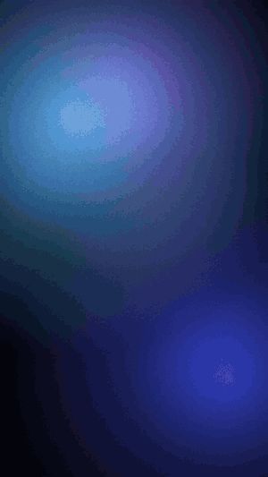
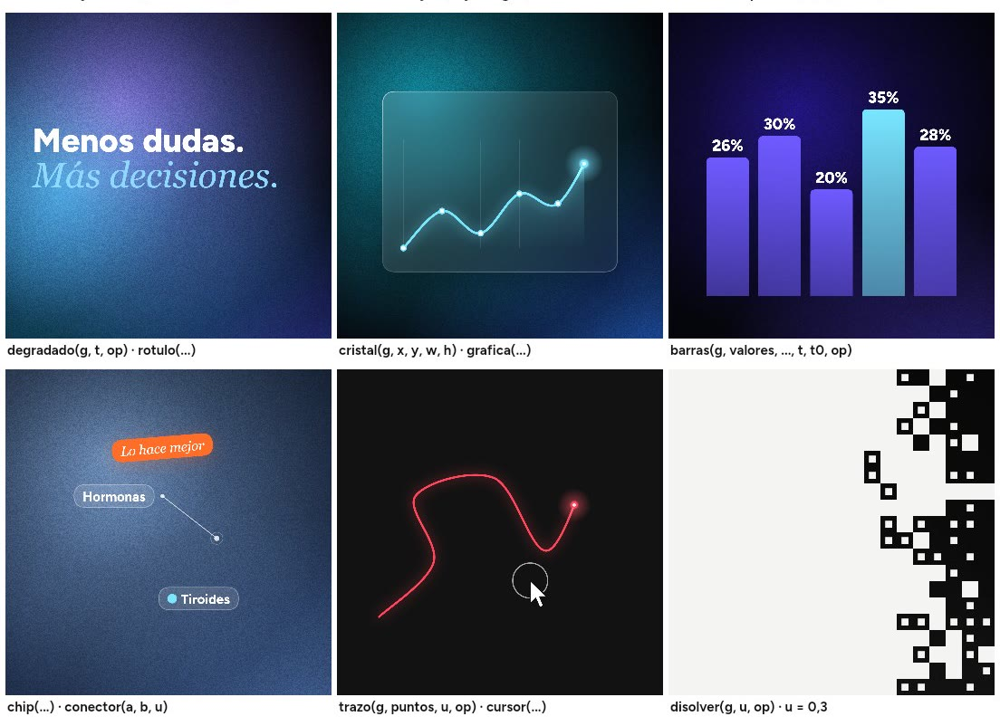
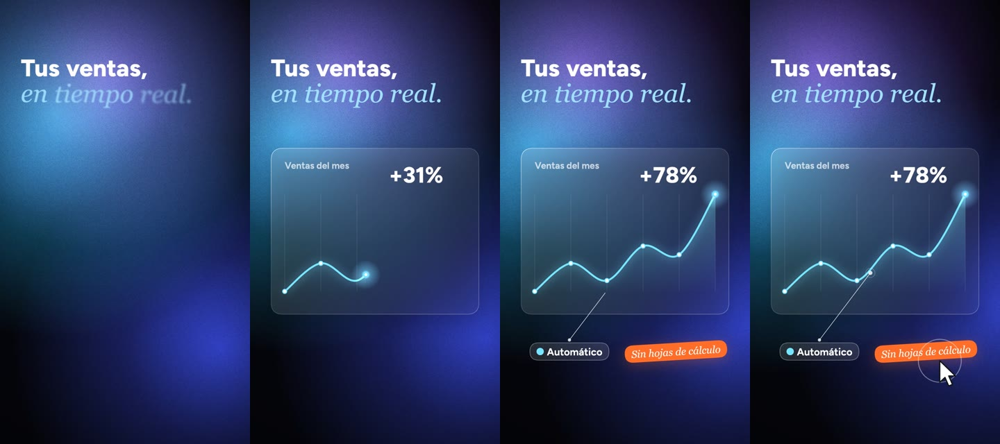

<b>Reels y motion graphics dibujados por código.</b> 
Una idea entra; sale un vídeo vertical listo para publicar: guion, voz, animación, sonido y portada.

<a href="media/demo.mp4">Ver la demo en mejor calidad (mp4)</a>

---

## Qué hace

- **Del tema al vídeo.** Investiga el tema, escribe el guion para la vista, genera la voz y planea cada plano frase a
  frase.
- **Animación hecha a medida, no plantillas.** Cada plano se dibuja por código: cámara que viaja, luz, volumen,
  partículas y tipografía cinética, sincronizados palabra por palabra con la voz.
- **Acabado de cine.** Desenfoque de movimiento real, resplandor, aberración, viñeta y grano.
- **Sonido con cuerpo.** Efectos colocados en el fotograma exacto de cada movimiento, música agachada bajo la voz y
  graves en los golpes que pesan.
- **Revisión en movimiento.** Antes de entregar, revisa cortes, saltos, huecos sin sonido y legibilidad en móvil.

## Motion de marca

El lenguaje de los anuncios de SaaS, fintech y salud, listo para usar en cualquier pieza:

| | |
|---|---|
| **Fondos vivos** | Degradados que respiran, con grano y viñeta |
| **Cristal** | Tarjetas de cristal esmerilado con borde de luz y sombra |
| **Datos** | Gráficas que se dibujan con una cabeza de luz; barras con rebote y cifras que corren |
| **Interfaz** | Pastillas, conectores y un cursor que pulsa |
| **Tipografía** | Rótulos que mezclan sans y cursiva de serifa, palabra a palabra |
| **Transiciones** | Disolución de píxeles |

## Formato

Vertical 1080 × 1920 · 30–60 s · para Reels, TikTok y Shorts · en español o inglés.

---

El código es privado. Esta página es una vitrina. 
¿Quieres un vídeo o una licencia? Escríbenos a <a href="mailto:oscar_8291@hotmail.com">oscar_8291@hotmail.com</a>.

