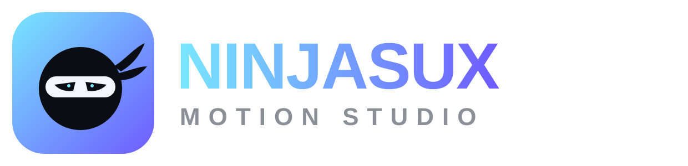
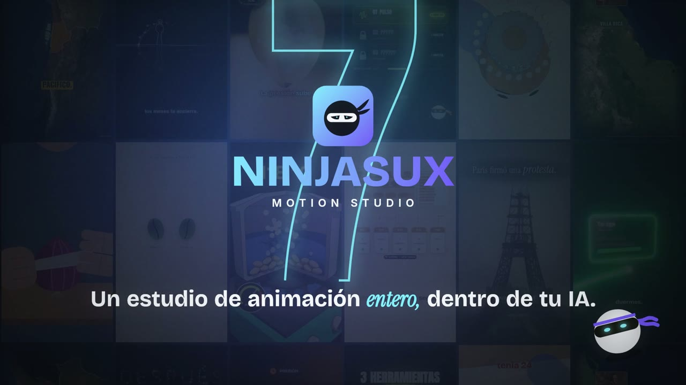
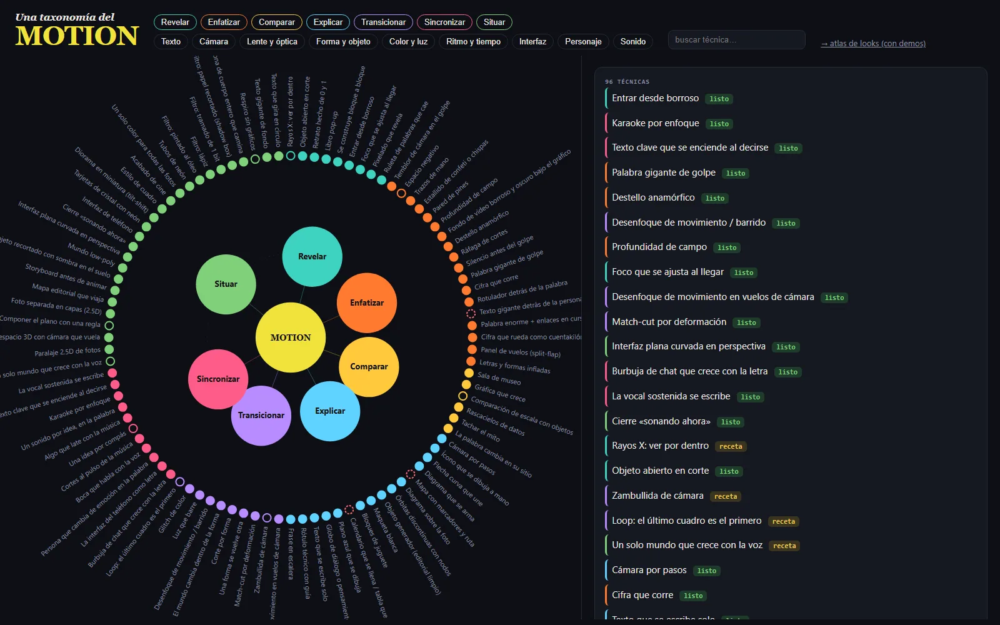
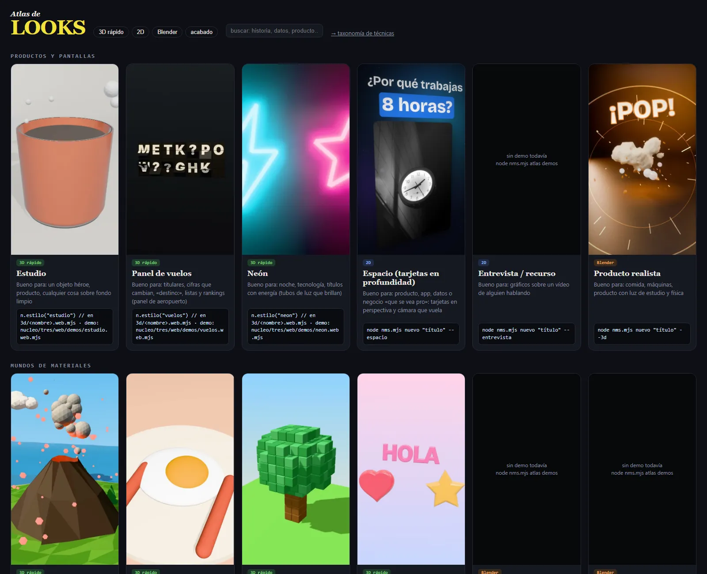

<b>Le cuentas la idea a tu asistente de IA. Te entrega el vídeo animado.</b> 
Guion, voz, animación 2D y 3D, mapas, un editor tipo CapCut, efectos, música al pulso y portada. En tu computadora.

<a href="https://ninjaasux.github.io/ninjasux-motion-studio-demo/"><b>▶ Ver la demo con los vídeos</b></a>

 
El tráiler de la 7 está hecho con la propia herramienta.

---

## Qué hay dentro (versión 7)

| | Qué hace | Por qué importa |
|---|---|---|
| 🧠 **El cerebro** | 152 técnicas de motion en 7 operaciones (revelar, enfatizar, comparar, explicar, transicionar, sincronizar, situar), cada una con qué comunica, cuándo usarla, su código y ejemplos reales | Tu IA dirige cada plano con criterio: los vídeos no salen genéricos |
| 🎬 **El estudio** | Un editor tipo CapCut en tu computadora: textos animados, títulos con sonido, subtítulos por trozo, efectos que se ponen solos, grabar tu voz y ver el cerebro decidir | Lo ves y lo tocas sin saber programar |
| 🎨 **Estilos y looks** | 23 estilos con su muestra en movimiento y 39 looks: 2D, 3D realista (Blender), 3D rápido sin Blender, mapas de cualquier país, documental, editorial, acuarela, persona 2D… | Eliges el look en segundos y cada uno trae su plantilla |
| ✍️ **Guionista** | Guiones de cualquier nicho con 8 moldes probados, datos verificados, 5 títulos, texto de portada y post | El vídeo se gana en el guion |
| 🗣️ **Voces** | ElevenLabs, Gemini, OpenRouter o voces locales gratis; diálogos con varios personajes y boca sincronizada | Historias con personajes, no solo narración |
| 🎵 **Montaje al pulso** | Analiza tu música (BPM, compases, subidas) y corta en el pulso; elige pistas de tu biblioteca por cómo suenan | El ritmo que separa lo pro de lo amateur |
| 🖼️ **Material real** | Busca fotos con licencia libre, quita fondos, da profundidad 2.5D, genera imágenes y unifica todo con un tono | Sin material y sin un solo tono, todo parece diapositivas |
| 🧪 **Revisión** | Storyboard antes de animar, hojas de contacto con retícula de composición y análisis de cualquier reel de referencia | Se corrige barato, antes de renderizar |

 El cerebro: las 152 técnicas que usa tu IA para dirigir cada plano.

 El atlas: cada look con su demo, para qué sirve y el comando.

---

Ninjasux Motion Studio · el código es privado; este repositorio es solo la vitrina.
[Ver los ejemplos](https://ninjaasux.github.io/ninjasux-motion-studio-demo/#ejemplos) ·
[Ver las portadas](https://ninjaasux.github.io/ninjasux-motion-studio-demo/#portadas).
Los artes de portada se generaron con IA.
¿Quieres una licencia? Escribe a <a href="mailto:oscar_8291@hotmail.com">oscar_8291@hotmail.com</a>.
