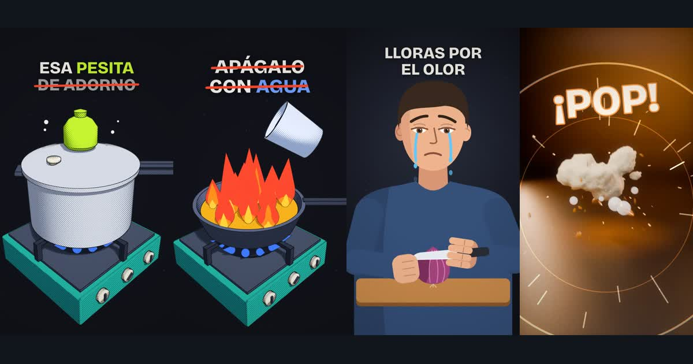

<b>Le cuentas la idea a tu asistente de IA. Te entrega el reel animado.</b> 
Guion, voz, animación 2D y 3D, texto en pantalla, efectos, música y portada. En tu computadora.

<a href="https://ninjaasux.github.io/ninjasux-motion-studio-demo/"><b>▶ Ver la demo con los 7 videos</b></a>

---

Ninjasux Motion Studio 4 · el código es privado; este repositorio es solo la vitrina.
¿Quieres una licencia? Escribe a <a href="mailto:oscar_8291@hotmail.com">oscar_8291@hotmail.com</a>.
